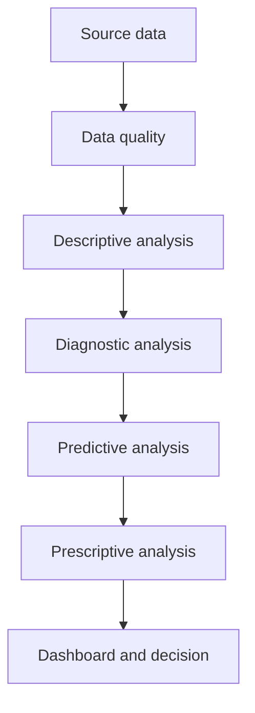

# Analysis Roadmap

## Analysis architecture

## Analysis 01 — Portfolio coverage

- Data: vehicle catalog
- Dimensions: brand, model, powertrain
- KPIs: model count, brand share, electrified model share
- Chart: brand model count and powertrain mix
- Decision: identify portfolio concentration and gaps
- Status: Complete

## Analysis 02 — EV and Hybrid readiness

- Data: vehicle catalog and UAE policy targets
- KPIs: EV/Hybrid model share, target gap, target growth path
- Chart: target line and model coverage comparison
- Decision: stage EV investment across entry, mid and premium segments
- Status: Complete

## Analysis 03 — Price positioning

- Data: listed vehicle prices
- KPIs: minimum, median, maximum and price band
- Chart: box plot and model ranking
- Decision: identify affordable EV and Hybrid entry points
- Status: Complete

## Analysis 04 — Total Cost of Ownership

- Data: price, annual energy, service cost and resale assumptions
- KPIs: five-year energy cost, service cost, resale-adjusted TCO
- Chart: TCO model comparison
- Decision: compare purchase price with ownership economics
- Caveat: assumptions require finance validation
- Status: Complete

## Analysis 05 — Sales funnel

- Data: synthetic leads, test drives and sales
- KPIs: lead-to-test-drive, test-drive-to-sale and lead-to-sale conversion
- Chart: funnel and branch comparison
- Decision: identify branch and brand conversion gaps
- Status: Complete in operational model

## Analysis 06 — Revenue and profitability

- Data: synthetic units, average price and gross profit
- KPIs: revenue, gross profit, gross margin and average selling price
- Chart: brand and branch profitability
- Decision: balance volume and margin
- Status: Complete in data model

## Analysis 07 — Inventory optimization

- Data: on-hand units, monthly demand and lead time
- KPIs: inventory days, stockout risk and excess stock risk
- Chart: inventory days matrix
- Decision: prioritize replenishment and reduce slow-moving stock
- Status: Complete

## Analysis 08 — After-sales performance

- Data: service orders and promised versus actual minutes
- KPIs: on-time service, average repair time and service volume
- Chart: branch service control tower
- Decision: improve capacity, booking and parts planning
- Status: Complete in operational model

## Analysis 09 — Customer satisfaction

- Data: CSAT and resolution status
- KPIs: average CSAT, escalation rate and resolution rate
- Chart: CSAT by branch, brand and service type
- Decision: locate customer-experience failure points
- Status: Complete in synthetic model

## Analysis 10 — Customer voice

- Data: MotorClash, Reddit, forums and public review summaries
- KPIs: rating, review count, theme and sentiment
- Chart: service ratings and negative themes
- Decision: define hypotheses for survey and complaint analysis
- Caveat: public reviews are biased and partly anecdotal
- Status: Complete baseline

## Analysis 11 — Service delay risk

- Data: promised minutes, actual minutes, service type and branch
- KPI: late-risk score
- Model: demonstration risk scoring
- Decision: prioritize at-risk service orders
- Production improvement: use only features known before service completion
- Status: Complete demonstration

## Analysis 12 — Sales forecast

- Data: synthetic daily sales aggregated monthly
- KPI: next-month unit forecast and MAE
- Model: baseline linear trend
- Decision: create a starting point for demand planning
- Production improvement: time-series cross-validation and seasonality
- Status: Complete demonstration

## Analysis 13 — Fleet economics

- Data: fleet size, vehicle utilization and commercial fleet cases
- KPIs: fleet scale, utilization, downtime and lifecycle cost
- Chart: fleet opportunity and replacement cycle
- Decision: prioritize B2B fleet accounts
- Status: Baseline complete

## Analysis 14 — Charging infrastructure

- Data: UAE charging targets and Charge2MOOV public facts
- KPIs: target stations, charger capacity and utilization opportunity
- Chart: charging growth trajectory
- Decision: select charging pilot locations
- Status: Complete baseline

## Analysis 15 — Competitor benchmark

- Data: Toyota, BYD, Lexus, Volvo and Mercedes context
- Dimensions: positioning, electrification, portfolio breadth and service signal
- Chart: competitor matrix
- Decision: identify whitespace in price, EV and service propositions
- Status: Complete baseline

## Analysis 16 — Management recommendation

- Inputs: all analysis tracks
- Output: 90-day action plan
- Priority 1: branch and service control tower
- Priority 2: EV and charging pilot
- Priority 3: used-car quality and transparency program
- Status: Complete

## Analysis maturity model

| Level | Question answered | Project coverage |
|---|---|---|
| Descriptive | What happened or what exists? | Complete |
| Diagnostic | Why might it be happening? | Complete baseline |
| Predictive | What could happen next? | Demonstration complete |
| Prescriptive | What should management do? | Complete recommendations |
| Production | Can the company run this continuously? | Requires authorized data |
