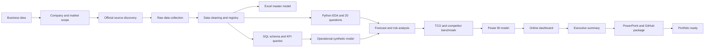

# Dubai Automotive Intelligence Platform Roadmap

## Project owner

Amir Kargar — Data Analysis

## Final objective

Build a complete automotive intelligence case study for the Dubai market using Excel, SQL, Python, Power BI, AI-assisted analysis and an online dashboard.



## Completed roadmap

| Phase | Work completed | Main outputs | Status |
|---|---|---|---|
| 1 | Business concept | Dubai Automotive Intelligence Platform scope | Complete |
| 2 | Company selection | Al-Futtaim Automotive, Toyota, Lexus, BYD, Volvo and Dubai ecosystem | Complete |
| 3 | Source discovery | Official company, brand, UAE policy, RTA and public review sources | Complete |
| 4 | Source governance | Source registry, site inventory, review collection plan and data dictionary | Complete |
| 5 | Public data | Vehicle catalog, pricing benchmarks, EV policy targets, charging targets and reviews | Complete |
| 6 | Data cleaning | Clean catalog, policy tables, public facts and Power BI-ready extracts | Complete |
| 7 | Excel | Master workbook for structured automotive analysis | Complete |
| 8 | SQL | SQLite database, schema, seed data, KPI queries and validation queries | Complete |
| 9 | Python EDA | Public data pipeline and vehicle catalog analysis | Complete |
| 10 | Key questions | Jupyter Notebook with 20 questions, charts and management analysis | Complete |
| 11 | Operational model | Synthetic daily sales, after-sales, inventory, forecast and risk files | Complete |
| 12 | Advanced analysis | TCO, competitor benchmark, sales forecast and service-risk demonstration | Complete |
| 13 | Alerts | Inventory-days and service on-time operational alert rules | Complete |
| 14 | Power BI | Operational model, DAX measures, KPI pages and report outline | Complete |
| 15 | Online dashboard | Interactive 20-question Al-Futtaim Automotive dashboard | Complete |
| 16 | Branding | Al-Futtaim Automotive identity, navy and cyan palette, Amir Kargar attribution | Complete |
| 17 | Executive communication | Executive summary, recommendations and video script | Complete |
| 18 | Presentation | English and Persian PowerPoint decks with rendered slide images | Complete |
| 19 | GitHub packaging | README, requirements, LICENSE, CONTRIBUTING and project structure | Complete |

## Current architecture

```text
Official sources and public reviews
              |
              v
01_Data_Raw -> 02_Data_Clean
              |
      +-------+--------+---------+
      v       v        v         v
   Excel    SQL     Python    Power BI
      |       |        |         |
      +-------+--------+---------+
              v
      Online dashboard
              |
              v
   Executive decisions and recommendations
```

## Current portfolio outputs

- Jupyter notebook with 20 analytical questions
- Interactive online dashboard
- Excel master workbook
- SQLite database and SQL scripts
- Synthetic operational data model
- TCO and competitor benchmark
- Forecast and service-risk demonstration
- Power BI model and DAX specification
- Executive summary
- English and Persian PowerPoint decks
- Persian, English and Arabic GitHub description in Word

## Remaining production steps

These steps require authorized company or partner data and are intentionally not fabricated:

1. Replace synthetic sales, service and inventory files with approved exports.
2. Connect CRM, DMS, service workshop and inventory systems.
3. Add branch-level Google review data through permitted access methods.
4. Validate TCO assumptions with finance, insurance and resale data.
5. Deploy the API with authentication and production monitoring.
6. Publish the GitHub repository and add screenshots and a short demo video.
7. Measure recommendation impact through a 90-day pilot.

## Portfolio narrative

The project starts with a public-data business question, builds a traceable data foundation, models an operating environment, answers practical management questions and ends with a dashboard, recommendations and an interview-ready presentation.
